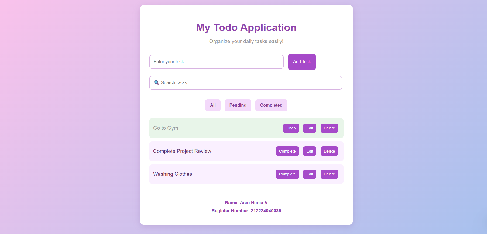
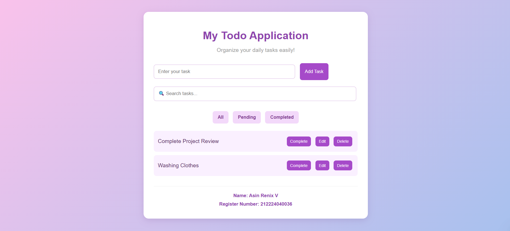
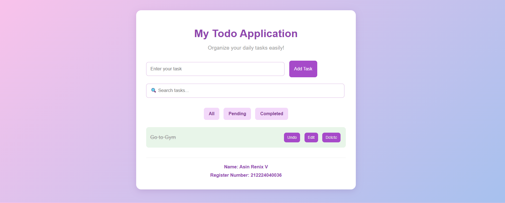

# Ex03 To-Do List using JavaScript
## Date: 17-11-2026

## AIM
To create a To-do Application with all features using JavaScript.

## ALGORITHM
### STEP 1
Build the HTML structure (index.html).

### STEP 2
Style the App (style.css).

### STEP 3
Plan the features the To-Do App should have.

### STEP 4
Create a To-do application using Javascript.

### STEP 5
Add functionalities.

### STEP 6
Test the App.

### STEP 7
Open the HTML file in a browser to check layout and functionality.

### STEP 8
Fix styling issues and refine content placement.

### STEP 9
Deploy the website.

### STEP 10
Upload to GitHub Pages for free hosting.

## PROGRAM
```
index.html

<!DOCTYPE html>
<html>
<head>
    <title>Todo Application</title>
    <link rel="stylesheet" href="style.css">
</head>
<body>

    <div class="container">
        <h1>My Todo Application</h1>
        <p class="subtitle">Organize your daily tasks easily!</p>

        <div class="input-section">
            <input type="text" id="taskInput"
                   placeholder="Enter your task">
            <button onclick="addTask()">Add Task</button>
        </div>

        <input type="text" id="searchInput"
               placeholder="🔍 Search tasks..."
               oninput="displayTasks()">

        <div class="filters">
            <button onclick="setFilter('all')">All</button>
            <button onclick="setFilter('pending')">Pending</button>
            <button onclick="setFilter('completed')">Completed</button>
        </div>

        <ul id="taskList"></ul>

        <footer>
            Name: Asin Renix V<br>
            Register Number: 212224040036
        </footer>
    </div>

    <script src="script.js"></script>
</body>
</html>

style.css


body {
    font-family: Arial, sans-serif;
    background: linear-gradient(135deg, #fbc2eb, #a6c1ee);
    margin: 0;
    padding: 40px 20px;
}

.container {
    background: white;
    max-width: 600px;
    margin: auto;
    padding: 30px;
    border-radius: 15px;
    box-shadow: 0 5px 20px rgba(120, 70, 140, 0.2);
}

h1 {
    text-align: center;
    color: #8e44ad;
    margin-bottom: 10px;
}

.subtitle {
    text-align: center;
    color: #999;
    margin-bottom: 25px;
}

.input-section {
    display: flex;
    gap: 10px;
}

input {
    padding: 12px;
    margin: 8px 0;
    width: 65%;
    border: 1px solid #d8b4e2;
    border-radius: 7px;
    outline: none;
    font-size: 14px;
}

input:focus {
    border-color: #a64ac9;
    box-shadow: 0 0 5px #e0b0ff;
}

button {
    padding: 11px 15px;
    margin: 4px;
    background: #a64ac9;
    color: white;
    border: none;
    border-radius: 7px;
    cursor: pointer;
    transition: 0.3s;
}

button:hover {
    background: #7d3c98;
    transform: translateY(-2px);
}

.input-section button {
    white-space: nowrap;
}

#searchInput {
    width: 95%;
    margin-top: 15px;
}

.filters {
    margin: 18px 0;
    text-align: center;
}

.filters button {
    background: #f3d9fa;
    color: #813c91;
    font-weight: bold;
}

.filters button:hover {
    background: #c77dff;
    color: white;
}

ul {
    padding: 0;
}

li {
    list-style: none;
    background: #faf0ff;
    padding: 12px;
    margin: 10px 0;
    border-radius: 8px;
    display: flex;
    align-items: center;
    gap: 5px;
    flex-wrap: wrap;
    color: #5b3268;
}

li span {
    flex: 1;
    overflow-wrap: anywhere;
}

.completed {
    text-decoration: line-through;
    color: #999;
    background: #e8f5e9;
}

li button {
    padding: 8px 10px;
    font-size: 12px;
}

footer {
    text-align: center;
    margin-top: 30px;
    padding-top: 15px;
    border-top: 1px solid #eee;
    font-size: 14px;
    line-height: 1.8;
    color: #8e44ad;
    font-weight: bold;
}

@media (max-width: 480px) {
    .container {
        padding: 18px;
    }

    .input-section {
        flex-direction: column;
    }

    .input-section input {
        width: auto;
    }

    #searchInput {
        width: 90%;
    }
}

script.js


let tasks = JSON.parse(localStorage.getItem("tasks")) || [];
let currentFilter = "all";

function saveTasks() {
    localStorage.setItem("tasks", JSON.stringify(tasks));
}

function addTask() {
    let input = document.getElementById("taskInput");
    let task = input.value.trim();

    if (task === "") {
        alert("Please enter a task!");
        return;
    }

    tasks.push({
        id: Date.now(),
        name: task,
        completed: false
    });

    input.value = "";
    saveTasks();
    displayTasks();
}

function displayTasks() {
    let list = document.getElementById("taskList");
    let search = document.getElementById("searchInput")
                      .value.toLowerCase();

    list.innerHTML = "";

    let filteredTasks = tasks.filter(task => {
        let matchesSearch = task.name.toLowerCase().includes(search);

        let matchesFilter =
            currentFilter === "all" ||
            (currentFilter === "pending" && !task.completed) ||
            (currentFilter === "completed" && task.completed);

        return matchesSearch && matchesFilter;
    });

    filteredTasks.forEach(task => {
        let li = document.createElement("li");

        if (task.completed) {
            li.classList.add("completed");
        }

        let name = document.createElement("span");
        name.textContent = task.name;

        let completeBtn = document.createElement("button");
        completeBtn.textContent = task.completed ? "Undo" : "Complete";
        completeBtn.onclick = () => toggleTask(task.id);

        let editBtn = document.createElement("button");
        editBtn.textContent = "Edit";
        editBtn.onclick = () => editTask(task.id);

        let deleteBtn = document.createElement("button");
        deleteBtn.textContent = "Delete";
        deleteBtn.onclick = () => deleteTask(task.id);

        li.append(name, completeBtn, editBtn, deleteBtn);
        list.appendChild(li);
    });
}

function toggleTask(id) {
    tasks = tasks.map(task =>
        task.id === id
            ? {...task, completed: !task.completed}
            : task
    );

    saveTasks();
    displayTasks();
}

function editTask(id) {
    let task = tasks.find(task => task.id === id);
    let newName = prompt("Edit your task:", task.name);

    if (newName !== null && newName.trim() !== "") {
        task.name = newName.trim();
        saveTasks();
        displayTasks();
    }
}

function deleteTask(id) {
    if (confirm("Are you sure you want to delete this task?")) {
        tasks = tasks.filter(task => task.id !== id);
        saveTasks();
        displayTasks();
    }
}

function setFilter(filter) {
    currentFilter = filter;
    displayTasks();
}

displayTasks();

```

## OUTPUT




## RESULT
The program for creating To-do list using JavaScript is executed successfully.
